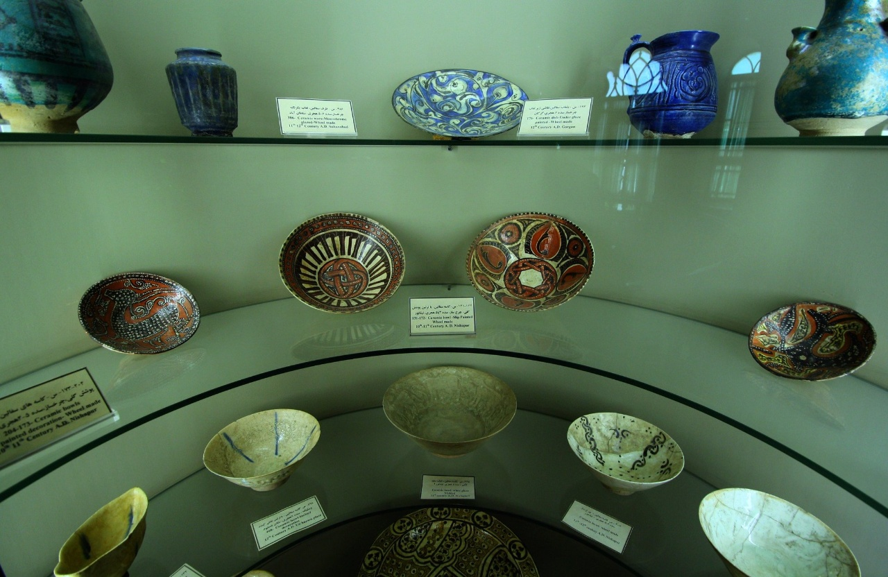

# dav2-13 검수표

## 노드

| ID | 라벨 | 신뢰도 | 2D 박스 (x1,y1,x2,y2) | 판정 / 수정 |
|---|---|---:|---|---|
| obj-000 | 가운데 ceramic bowl #000 | 0.965 | [552, 528, 745, 659] | 미검수 |
| obj-001 | 오른쪽 ceramic bowl #001 | 0.965 | [818, 595, 986, 714] | 미검수 |
| obj-002 | 왼쪽 ceramic bowl #002 | 0.965 | [292, 589, 461, 708] | 미검수 |
| obj-003 | 오른쪽 ceramic bowl #003 | 0.961 | [1007, 704, 1240, 832] | 미검수 |
| obj-004 | 왼쪽 ceramic bowl #004 | 0.957 | [77, 703, 213, 832] | 미검수 |
| obj-005 | 왼쪽 ceramic bowl #005 | 0.953 | [402, 306, 584, 451] | 미검수 |
| obj-007 | 오른쪽 ceramic bowl #007 | 0.941 | [1079, 435, 1263, 549] | 미검수 |
| obj-008 | 왼쪽 ceramic bowl #008 | 0.938 | [113, 392, 288, 510] | 미검수 |
| obj-009 | 가운데 ceramic bowl #009 | 0.930 | [565, 99, 760, 199] | 미검수 |
| obj-010 | 가운데 ceramic bowl #010 | 0.754 | [516, 730, 776, 832] | 미검수 |
| obj-011 | 오른쪽 ceramic jug #011 | 0.863 | [899, 43, 1037, 199] | 미검수 |
| obj-012 | 오른쪽 ceramic jug #012 | 0.852 | [1116, 0, 1280, 196] | 미검수 |
| obj-013 | 왼쪽 ceramic jug #013 | 0.668 | [0, 0, 164, 192] | 미검수 |
| obj-014 | 왼쪽 ceramic jug #014 | 0.660 | [239, 68, 343, 197] | 미검수 |
| obj-015 | 가운데 glass shelf #015 | 0.715 | [0, 192, 1280, 214] | 미검수 |
| obj-016 | 가운데 glass shelf #016 | 0.648 | [0, 411, 1280, 806] | 미검수 |
| obj-018 | 왼쪽 label #018 | 0.918 | [362, 715, 471, 793] | 미검수 |
| obj-019 | 오른쪽 label #019 | 0.918 | [810, 722, 911, 798] | 미검수 |
| obj-020 | 가운데 label #020 | 0.910 | [591, 428, 686, 484] | 미검수 |
| obj-021 | 가운데 label #021 | 0.906 | [606, 685, 685, 720] | 미검수 |
| obj-022 | 오른쪽 label #022 | 0.898 | [746, 141, 854, 197] | 미검수 |
| obj-023 | 왼쪽 label #023 | 0.898 | [398, 140, 515, 196] | 미검수 |
| obj-024 | 왼쪽 label #024 | 0.895 | [0, 531, 162, 672] | 미검수 |
| obj-025 | 왼쪽 label #025 | 0.797 | [245, 812, 295, 832] | 미검수 |

## 관계

| 번호 | 주체 | 관계 | 대상 | 판정 / 수정 |
|---:|---|---|---|---|
| 0 | 왼쪽 label #023 | on | 가운데 glass shelf #015 | 미검수 |
| 1 | 오른쪽 label #022 | on | 가운데 glass shelf #015 | 미검수 |
| 2 | 왼쪽 ceramic bowl #005 | on | 가운데 glass shelf #016 | 미검수 |
| 3 | 오른쪽 ceramic jug #011 | on | 가운데 glass shelf #015 | 미검수 |
| 4 | 왼쪽 ceramic jug #014 | on | 가운데 glass shelf #015 | 미검수 |
| 5 | 가운데 ceramic bowl #010 | under | 가운데 glass shelf #016 | 미검수 |
| 6 | 왼쪽 label #025 | under | 가운데 glass shelf #016 | 미검수 |
| 7 | 가운데 glass shelf #016 | under | 가운데 glass shelf #015 | 미검수 |
| 8 | 가운데 ceramic bowl #009 | next to | 왼쪽 label #023 | 미검수 |
| 9 | 오른쪽 ceramic jug #011 | next to | 오른쪽 label #022 | 미검수 |
| 10 | 오른쪽 ceramic jug #011 | next to | 오른쪽 ceramic jug #012 | 미검수 |
| 11 | 왼쪽 ceramic jug #014 | next to | 왼쪽 label #023 | 미검수 |
| 12 | 가운데 ceramic bowl #000 | next to | 오른쪽 ceramic bowl #001 | 미검수 |
| 13 | 가운데 ceramic bowl #000 | next to | 왼쪽 ceramic bowl #002 | 미검수 |
| 14 | 가운데 ceramic bowl #009 | next to | 오른쪽 ceramic jug #011 | 미검수 |
| 15 | 왼쪽 ceramic jug #013 | next to | 왼쪽 label #023 | 미검수 |
| 16 | 오른쪽 ceramic jug #012 | next to | 오른쪽 label #022 | 미검수 |
| 17 | 왼쪽 ceramic bowl #005 | left of | 가운데 label #020 | 미검수 |
| 18 | 왼쪽 ceramic bowl #004 | in front of | 왼쪽 ceramic bowl #002 | 미검수 |
| 19 | 가운데 ceramic bowl #010 | left of | 오른쪽 label #019 | 미검수 |
| 20 | 왼쪽 ceramic bowl #004 | in front of | 왼쪽 label #025 | 미검수 |
| 21 | 왼쪽 label #018 | left of | 가운데 ceramic bowl #010 | 미검수 |
| 22 | 왼쪽 label #024 | in front of | 왼쪽 ceramic bowl #008 | 미검수 |
| 23 | 오른쪽 ceramic bowl #003 | in front of | 오른쪽 label #019 | 미검수 |
| 24 | 가운데 glass shelf #015 | in front of | 왼쪽 ceramic bowl #008 | 미검수 |
| 25 | 가운데 ceramic bowl #000 | left of | 오른쪽 label #019 | 미검수 |
| 26 | 가운데 glass shelf #015 | left of | 오른쪽 ceramic bowl #007 | 미검수 |
| 27 | 오른쪽 ceramic jug #012 | in front of | 오른쪽 ceramic bowl #007 | 미검수 |

## 누락 항목

물체는 개체별 한 줄, 관계는 주체 / 관계 / 대상으로 추가해 주세요.
